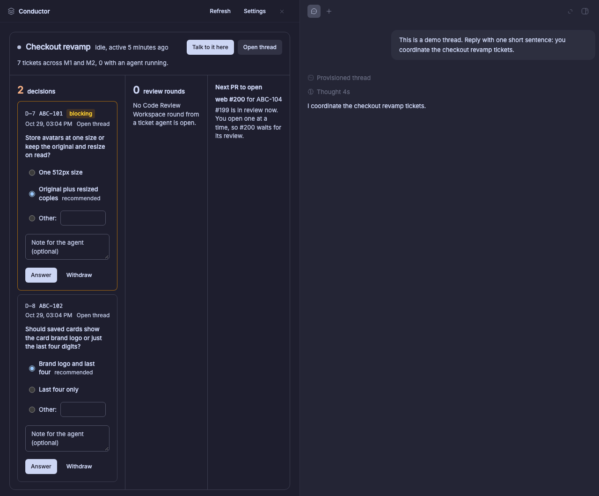
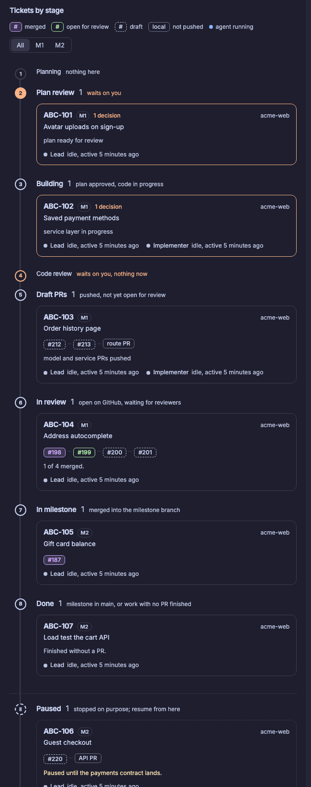
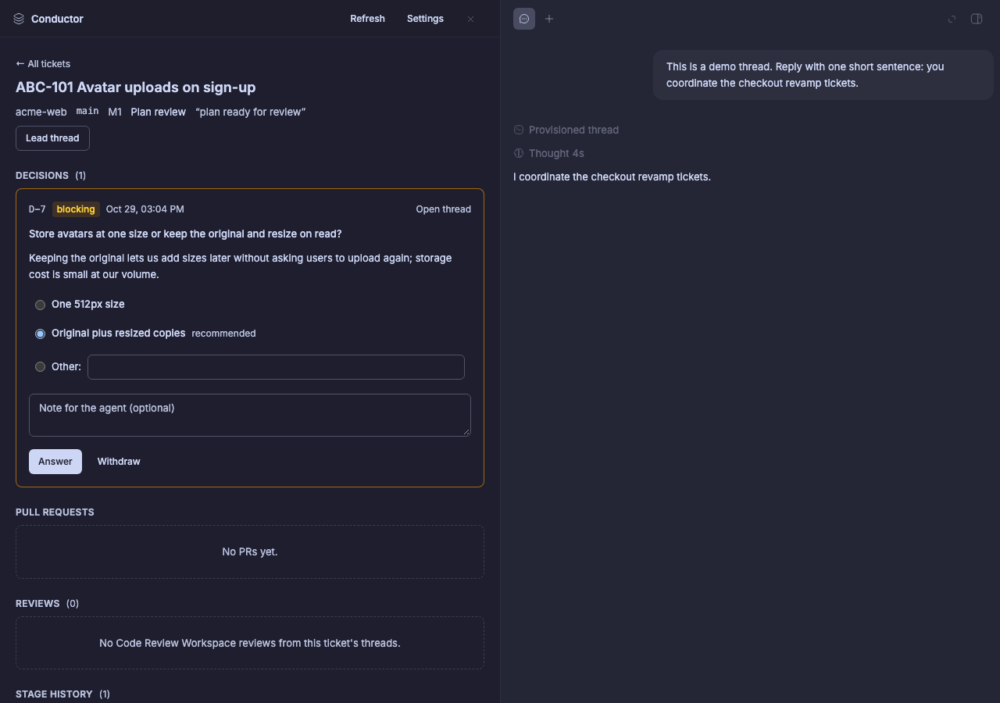
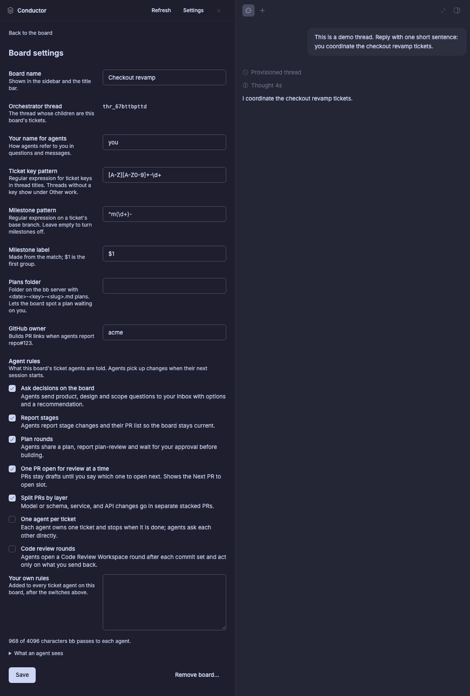

# Conductor

A [bb](https://getbb.app) plugin for running many coding agents at once. You
keep one **orchestrator** thread; every thread it starts for a ticket shows up
on a board with its stage, pull requests and review rounds. Agents send you
**decisions** with their options and reasoning, you answer once, and the
answer goes straight back to the agent that asked.



## What you get

- **A board per orchestrator.** Tickets sit in stage sections: Planning, Plan
  review, Building, Code review, Draft PRs, In review, In milestone (or
  Merged), Done, plus Paused. Each card shows the PR stack, whether the lead
  and implementer agents are running, and what waits on you.
- **A decision inbox.** Agents call `conductor_ask_decision`; the question,
  options, recommendation and reasoning land in your inbox, on the agent's
  thread and as a badge on the rail icon. Your answer is sent to the agent as a
  message.
- **Plan review.** Agents send their plan with `conductor_submit_plan`. You
  read it rendered, select text to comment on it, remove it or replace it,
  add an overall comment, and approve or request changes. The marks go back
  to the agent as one message, and each round keeps its own copy with a diff
  against the round before.
- **The orchestrator beside the board.** The side panel has an Orchestrator
  tab, and clicking an agent on a card opens its thread as a tab.
- **Ticket context on every agent thread**: Info rows, a line above the
  composer where you can answer decisions, and a header chip.
- **Rules you choose.** Per board, switch on what agents are told: ask
  decisions on the board, report stages, plan rounds, one PR open for review
  at a time, PRs split by layer, one agent per ticket, Code Review Workspace
  reviews (agents open a review of their folder, report on each comment you
  send and don't push until told). Add your own text too.

<p>
  
  
</p>

## Install

```
bb plugin install git:github.com/adammahood/bb-plugin-conductor@^0.2.0
```

Needs bb 0.47 or newer. Conductor uses `experimental_` bb plugin APIs, so a bb
update can break parts of it; each surface fails on its own.

## Start a board

1. Open **Conductor** in the left rail and pick an existing thread as the
   orchestrator, or start a new one in a project. You can also choose
   **Use as a Conductor board** from any thread's menu, or run
   `bb conductor board create --thread <thread id>`.
2. Have the orchestrator start one thread per ticket with the ticket key in
   its title, for example `ABC-123 add avatar uploads`. Threads that ticket
   threads start are their implementers. Children without a key show under
   *Other work*.
3. Open **Settings** on the board to set your name for agents, the ticket key
   pattern, milestones from branch names, a plans folder and the rule
   switches. Agents pick up changes when their next session starts.



## Optional plugins

| Plugin | Adds |
| --- | --- |
| [Linear](https://github.com/vburojevic/bb-plugin-linear) | Ticket keys from issue bindings, issue state, description and relations |
| Code Review Workspace 1.10 or newer | Reviews of each ticket's folder and threads with their status; Code review stage; **Review changes** on the ticket page |
| GitHub PR Status (bundled) | The PR of each ticket's branch |

Without them the board works from thread titles and what agents report.
Code Review Workspace counts as missing while it doesn't answer its review
status, as when it's older than 1.10, disabled or starting.

A review belongs to a ticket when it is of the ticket's folder or linked to
one of its threads. Cards and the ticket page show Code Review Workspace's own
status, such as "Ready to re-review" or "2 of 6 reported". In the Reviews
section of a ticket's page, **Open review** goes to the ticket's live review;
with none, **Review changes** starts a review of its folder from the lead
thread.

## How stages are decided

The first rule that matches wins:

1. **Paused** when an agent reports it.
2. **Code review** while a Code Review Workspace review of the ticket's
   folder or threads waits on you; **Building** while your comments or a Push
   are with the agent, or a PR not under your login waits on its author, until
   the agent reports again. A review that waits on nobody (a draft, a snooze, a
   folder on another branch or removed) doesn't hold the stage. Approved and
   archived reviews are finished, and one merged into another is dropped.
3. **In review** when a PR is open for review; **In milestone** when all PRs
   are merged.
4. The stage the agent **reported**, if any.
5. **Plan review** when a plan file for the ticket waits on you (needs a plans
   folder).
6. **Draft PRs**, **Building** (an agent is running) or **Planning** from the
   facts.

## CLI

`bb conductor tickets | decisions | answer | withdraw | report | sweep`,
`bb conductor board list | create | set | remove`, and
`bb conductor import-phase-board`. Run any with `--help`.

## Data

Everything lives in the plugin's SQLite database on your bb server. Each
person's bb holds their own boards; nothing is shared. A bb server shared by
several people is not supported.

## Develop

```
npm install
npm run check        # tsc + vitest
bb plugin build
bb plugin install .  # then `bb plugin dev` to iterate
```
