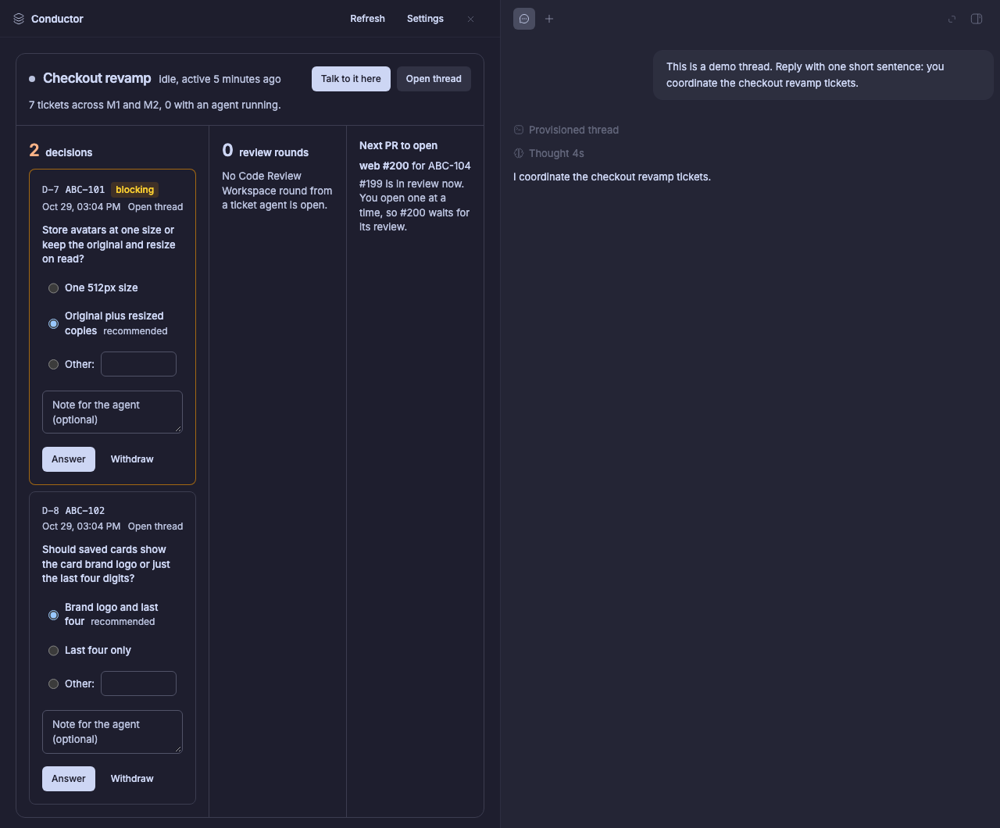
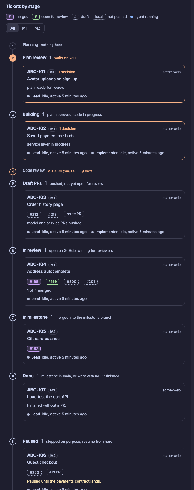
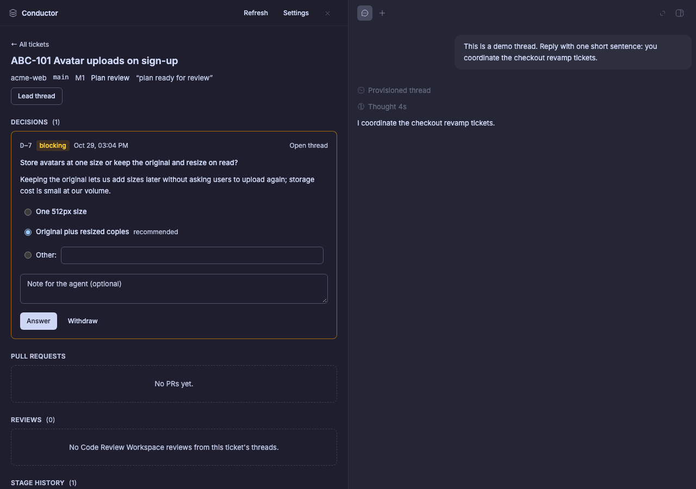
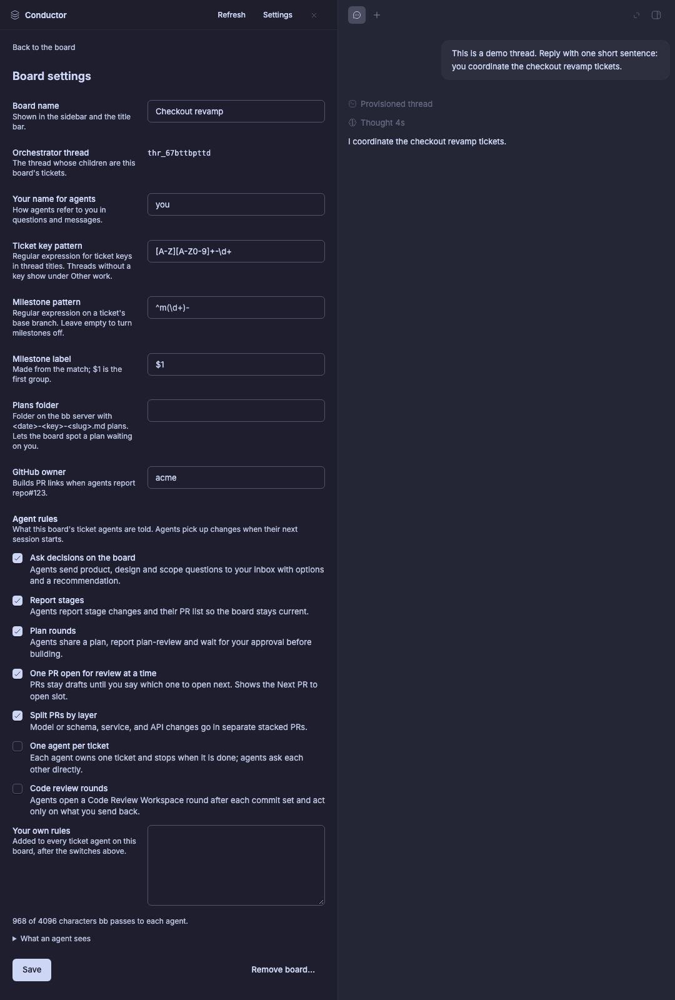

# Conductor

A [bb](https://getbb.app) plugin for running many coding agents at once. You
keep one **orchestrator** thread; every thread it starts for a ticket shows up
on a board with its stage, pull requests and review rounds. Agents send you
**decisions** with their options and reasoning, you answer once, and the
answer goes straight back to the agent that asked.



## What you get

- **A board per orchestrator.** Tickets sit in stage sections: Planning, Plan
  review, Building, Code review, Draft PRs, In review, In milestone (or
  Merged), Done, plus Paused. Each card shows the PR stack, whether the lead
  and implementer agents are running, and what waits on you.
- **A decision inbox.** Agents call `conductor_ask_decision`; the question,
  options, recommendation and reasoning land in your inbox, on the agent's
  thread and as a badge on the rail icon. Your answer is sent to the agent as a
  message.
- **Plan review.** Agents send their plan with `conductor_submit_plan`. You
  read it rendered, select text to comment on it, remove it or replace it,
  add an overall comment, and approve or request changes. The marks go back
  to the agent as one message, and each round keeps its own copy with a diff
  against the round before. Agents ask their decisions before submitting (a
  plan is refused while the ticket has open decisions), and asking one while
  a round is open withdraws it; agents can also withdraw a round themselves.
  A round stays open until you decide it or the agent submits again; if the agent edits the file in between, the round says
  so. With a plans folder set, a plan found there opens a round on its own,
  but only for tickets whose agent never submitted one.
- **The orchestrator beside the board.** The side panel has an Orchestrator
  tab, and clicking an agent on a card opens its thread as a tab.
- **Ticket context on every agent thread**: Info rows, a line above the
  composer where you can answer decisions, and a header chip.
- **Rules you choose.** Per board, switch on what agents are told: ask
  decisions on the board, report stages, plan rounds, one PR open for review
  at a time, PRs split by layer, one agent per ticket, Code Review Workspace
  rounds. Add your own text too.

<p>
  
  
</p>

## Install

```
bb plugin install git:github.com/adammahood/bb-plugin-conductor@^0.2.0
```

Needs bb 0.47 or newer. Conductor uses `experimental_` bb plugin APIs, so a bb
update can break parts of it; each surface fails on its own.

## Start a board

1. Open **Conductor** in the left rail and pick an existing thread as the
   orchestrator, or start a new one in a project. You can also choose
   **Use as a Conductor board** from any thread's menu, or run
   `bb conductor board create --thread <thread id>`.
2. Have the orchestrator start one thread per ticket with the ticket key in
   its title, for example `ABC-123 add avatar uploads`. Threads that ticket
   threads start are their implementers. Children without a key show under
   *Other work*.
3. Open **Settings** on the board to set your name for agents, the ticket key
   pattern, milestones from branch names, a plans folder and the rule
   switches. Agents pick up changes when their next session starts.



## Optional plugins

| Plugin | Adds |
| --- | --- |
| [Linear](https://github.com/vburojevic/bb-plugin-linear) | Ticket keys from issue bindings, issue state, description and relations |
| Code Review Workspace | Review rounds waiting on you; Code review stage |
| GitHub PR Status (bundled) | The PR of each ticket's branch |
| `gh` CLI, logged in | Done once a milestone is released |

Without them the board works from thread titles and what agents report.

## How stages are decided

The first rule that matches wins:

1. **Paused** when an agent reports it.
2. **Code review** while a Code Review Workspace round waits on you;
   **Building** once you sent comments back, until the agent reports again.
3. **Plan review** while a plan round waits on you.
4. **Done** when Linear has the issue in a completed state and every PR on
   the ticket is merged or closed. Linear often closes a ticket when the first
   PR of a chain merges; until the rest land, the card says "Linear says Done;
   N PRs still open".
5. **Blocked** when an agent reports it, until it reports another stage.
6. **In review** when a PR is open for review; **In milestone** when all PRs
   are merged; **Done** once those PRs have reached the default branch: merged
   straight into it, or their base branch merged into it by a later release
   PR or as an ancestor. Held and closed PRs are left out. GitHub is asked
   through `gh` on the bb server.
7. The stage the agent **reported**, if any.
8. **Draft PRs**, **Building** (an agent is running) or **Planning** from the
   facts.

## Blocked tickets

An agent that cannot continue until another ticket lands reports the stage
`blocked` with the keys it waits on and the reason, then ends its turn (or
`bb conductor report <key> --stage blocked --blocked-by <key> --note ...`).
The board shows it in its own Blocked section, says what it waits on and how
each blocking ticket moved since, and offers **Tell the agent** once one is
Done. With "Tell blocked agents automatically when their blocker is Done" on,
the board sends that message itself once every blocking ticket is Done.

## Done tickets

- The board shows Done tickets for a few days (3 by default, per board). After
  that, or once their threads are archived, they move to the Done list, which
  you open from the board or the sidebar's "Done (N)" row. It can be filtered,
  and every ticket keeps its page and history.
- Done tickets' decisions, plans and review rounds leave the badge, the inbox
  and Waiting on you.
- With "Archive a ticket's threads when it's Done" on, the board archives a
  Done ticket's lead and implementer threads (never the orchestrator) once:
  - no PR is open, draft, held or unpushed;
  - its agents are idle and nothing waits on you;
  - every worktree has no uncommitted changes or unpushed commits;
  - no other ticket or thread uses the same worktree.

  Otherwise the ticket shows why it is kept, and the next sweep tries again.
  Tickets sharing a lead or a worktree go together. bb may remove an archived
  worktree's folder; the branch stays. **Unarchive** on the ticket brings the
  threads back and rebuilds removed worktrees, and the board leaves that
  ticket alone afterwards. Nothing is ever deleted.

## CLI

`bb conductor tickets | decisions | answer | withdraw | report | withdraw-plan | unarchive | sweep`,
`bb conductor board list | create | set | remove`, and
`bb conductor import-phase-board`. Run any with `--help`.

## Data

Everything lives in the plugin's SQLite database on your bb server. Each
person's bb holds their own boards; nothing is shared. A bb server shared by
several people is not supported.

## Develop

```
npm install
npm run check        # tsc + vitest
bb plugin build
bb plugin install .  # then `bb plugin dev` to iterate
```
